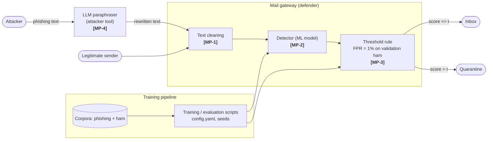
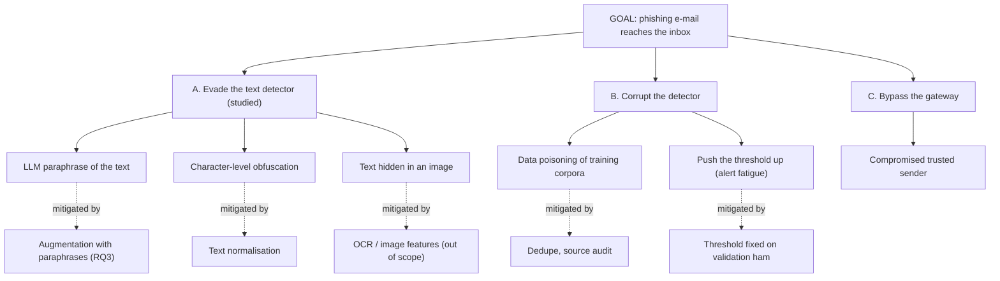

# Domain Model (Cybersecurity track): STRIDE Threat Matrix and Attack Tree

**System under analysis:** an e-mail security gateway that scores incoming messages with a text-based ML detector (TF-IDF + logistic regression, DistilBERT, zero-shot LLM) and quarantines a message when its score exceeds a threshold fixed at a false-positive rate of 1%. The experiment of this repository measures one threat: **evasion of the detector by an LLM-paraphrased phishing text** (threat T2b), and what happens to recall at the fixed threshold.

## 1. Components and trust boundaries

## 2. STRIDE threat matrix

| ID | STRIDE | Threat | Component | Example | Mitigation | Evidence / metric |
|----|--------|--------|-----------|---------|------------|-------------------|
| T1 | **S**poofing | Sender or brand impersonation (the phishing itself) | Mail gateway | Forged From header, look-alike domain | SPF / DKIM / DMARC (outside this study), content detector as second layer | Recall of the detector |
| T2a | **T**ampering | Training-data poisoning | Corpora, training pipeline | Flipped labels, planted mails in a public corpus | Dedupe by hash, remove conflicting labels, source audit, fixed split | Rows removed by cleaning (MP-1) |
| T2b | **T**ampering | **Evasion: adversarial rewriting of the input** | **Detector** | **LLM paraphrase keeps meaning and links, changes wording** | **Threshold rule fixed on original data, augmentation with paraphrases (RQ3)** | **Recall at FPR = 1%, paired original vs paraphrased (this repo)** |
| T3 | **R**epudiation | No trace of which model, threshold and data produced a decision | Training pipeline | Result cannot be reproduced or audited | Fixed seeds, exact pins, environment log, config in git | `results/benchmark.log` |
| T4 | **I**nformation disclosure | Private mail leaks through data or model | Corpora, weights | Real e-mails with personal data committed to git | Public corpora only, raw data not committed (`.gitignore`), licence check | Files tracked by git |
| T5 | **D**enial of service | Very long or crafted texts slow the (LLM) detector, or a flood of false alarms buries analysts | Detector | 100k-character mail, mail bombing | Truncate to `max_chars`, rate limit, guardrail FPR <= 2% | Realised FPR (guardrail) |
| T6 | **E**levation of privilege | Compromised model supply chain | Model weights, dependencies | Tampered weights or package | Exact version pins, official model hubs, hash check | `requirements.txt` |

Threat **T2b** is the one evaluated experimentally (`notebooks/01_data_analysis.ipynb`).

## 3. Attack tree for the goal "phishing mail reaches the inbox"

## 4. Metric collection points

| ID | Where | What is measured | Field (unit) | Role |
|----|-------|------------------|--------------|------|
| MP-1 | Text cleaning (`src/phishrobust/data.py`) | Rows after dedupe and label-conflict removal | counts | Data quality, T2a |
| MP-2 | Detector output | Score per e-mail | `score` (model units) | Input of the mathematical model |
| MP-3 | Threshold rule | Decision at the fixed threshold | `detected`, `threshold`, recall, FPR | Primary metric (recall at FPR = 1%) and guardrail (FPR <= 2%) |
| MP-4 | Paraphraser quality filter | Share of paraphrases accepted | `ok` | Validity of the attack simulation |

## 5. Mathematical model

Implemented in `src/signal_model.py`. Scores of original phishing e-mails are modelled as `s ~ N(mu, sigma^2)`; the threshold `t` is fixed on validation ham. Then

* recall (original) = `1 - Phi((t - mu) / sigma)`
* paraphrasing is a pure location shift `delta` = mean paired difference `s_para - s_orig`, so recall (paraphrased) = `1 - Phi((t - mu - delta) / sigma)`
* the shift that costs `d` percentage points of recall: `delta*(d) = (t - mu) - sigma * Phi^-1(1 - (recall_orig - d))`

The prediction uses only the original scores, the threshold and the paired mean shift; it is **not fitted** to the paraphrased recall. The notebook compares it with the measured recall. **Assumptions:** normal score distribution (poor for saturated scores such as DistilBERT probabilities, which is reported, not hidden), a change of location only (checked through the ratio of standard deviations), and independence of e-mails.
