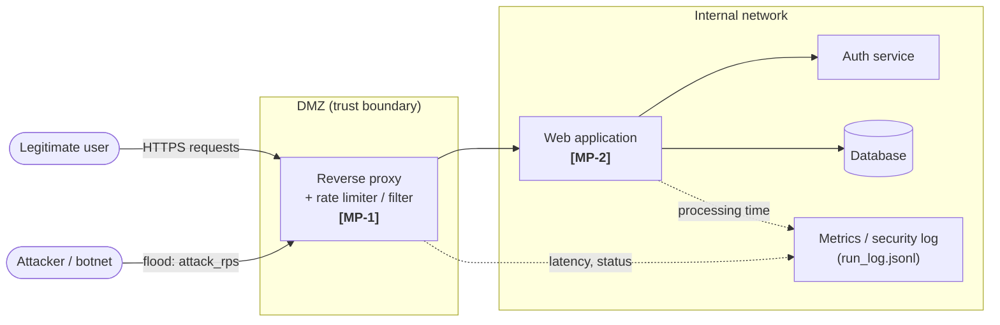
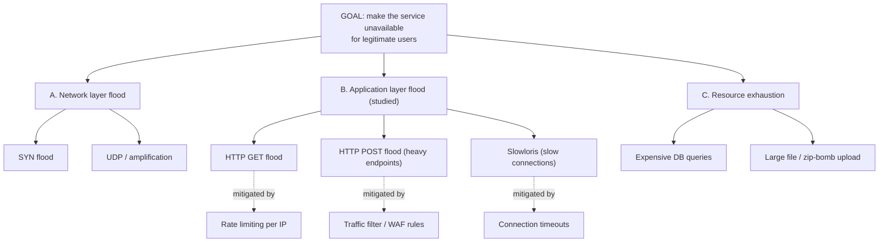

# Domain Model (Cybersecurity track): STRIDE Threat Matrix and Attack Tree

**System under analysis:** a public web application protected by a reverse proxy with a mitigation layer (rate limiting + traffic filter, the *Proposed* method). The benchmark measures one threat class, **HTTP flood (DoS/DDoS)**, and its effect on legitimate users.

## 1. System components and trust boundaries

## 2. STRIDE threat matrix

| ID | STRIDE | Threat | Protected component | Example attack | Mitigation | Evidence / metric |
|----|--------|--------|---------------------|----------------|------------|-------------------|
| T1 | **S**poofing | Attacker impersonates a user or forges source IPs | Auth service, Reverse proxy | Credential stuffing, IP spoofing | MFA, rate limit per account/IP, ingress filtering | Failed-login rate |
| T2 | **T**ampering | Request or data modified in transit or at rest | Web application, Database | Parameter tampering, SQL injection | TLS, input validation, parameterised queries, WAF | Blocked-request count |
| T3 | **R**epudiation | Attacker denies actions; no audit trail | Security log | Log deletion or forging | Append-only logs, timestamps, log shipping | Log completeness |
| T4 | **I**nformation disclosure | Sensitive data leaks | Database, Web application | Error-message leaks, data exfiltration | Least privilege, encryption, generic errors | Data-access audit |
| T5 | **D**enial of service | **HTTP flood exhausts server resources, legitimate requests slow down or fail** | **Reverse proxy, Web application** | **HTTP GET/POST flood (this study)** | **Rate limiting + traffic filter (Proposed)** | **Latency p50/p95/p99 and error rate of legitimate requests (this repo)** |
| T6 | **E**levation of privilege | Attacker gains higher privileges | Web application, Auth service | Broken access control, exploit chain | RBAC, patching, sandboxing | Privilege-change events |

Threat **T5 (Denial of service)** is the one evaluated experimentally in `notebooks/01_data_analysis.ipynb`.

## 3. Attack tree for the DoS goal (T5)

## 4. Metric collection points

| ID | Component | Measured | Field (unit) | Role |
|----|-----------|----------|--------------|------|
| MP-1 | Reverse proxy | End-to-end latency and status of **legitimate** requests | `latency_ms` (ms), `status` | Primary metric + guardrail (failed / wrongly blocked requests) |
| MP-2 | Web application | Processing time (fixed, 10 ms per request in `src/server.py`) | ms | Input of the queue model (section 5) |
| MP-3 | Attack generator (`src/run_experiment.py`) | Attack traffic rate | `attack_rps` (req/s) | Independent variable |

**Guardrail metric:** error rate of legitimate requests (%). A defence is only acceptable if it does not block legitimate users (false positives).

## 5. Mathematical model of the service (queueing theory)

Implemented in `src/model.py`; the notebook compares its prediction with the measurements.

The target service (`src/server.py`) has `c = 4` parallel workers, a fixed service time `s = 10 ms` and a FIFO queue. With request rate `lambda` the offered load is `a = lambda * s` (Erlang) and the utilisation is `rho = a / c`.

* Stable only if `rho < 1`. Probability that a request must wait (Erlang C):
  `C(c, a) = [a^c / (c! (1 - rho))] / [ sum_{k=0}^{c-1} a^k / k!  +  a^c / (c! (1 - rho)) ]`
* Mean waiting time, M/M/c: `Wq = C(c, a) * s / (c (1 - rho))`. A fixed service time (M/D/c) is approximated by the Allen-Cunneen factor `(1 + cs^2)/2 = 1/2`.
* Mean latency `W = s + Wq`. For `rho >= 1` the queue grows without bound, so the client timeout (1000 ms) is the cap.
* Arrival rate reaching the workers: Baseline `lambda = L + A`; Proposed `lambda = L + min(A, R)`, where `L = 20` req/s is the legitimate rate, `A` the attack rate and `R = 40` req/s the per-client rate limit (the surplus is answered `429` at once and never queues).

**Predictions (testable):** Baseline saturates at `L + A = c / s = 400` req/s, i.e. at `A = 380` req/s; below that latency rises slowly, above it every request waits until the timeout. Proposed never exceeds `rho = 0.15`, so its latency stays at about `s` for any `A`. **Assumptions and limits of the model:** Poisson arrivals, one attacker identity (the limiter sees one client), no network or kernel effects, no connection-setup cost; the measured latency contains about 1.5 ms of loopback/client overhead that the model does not include.
